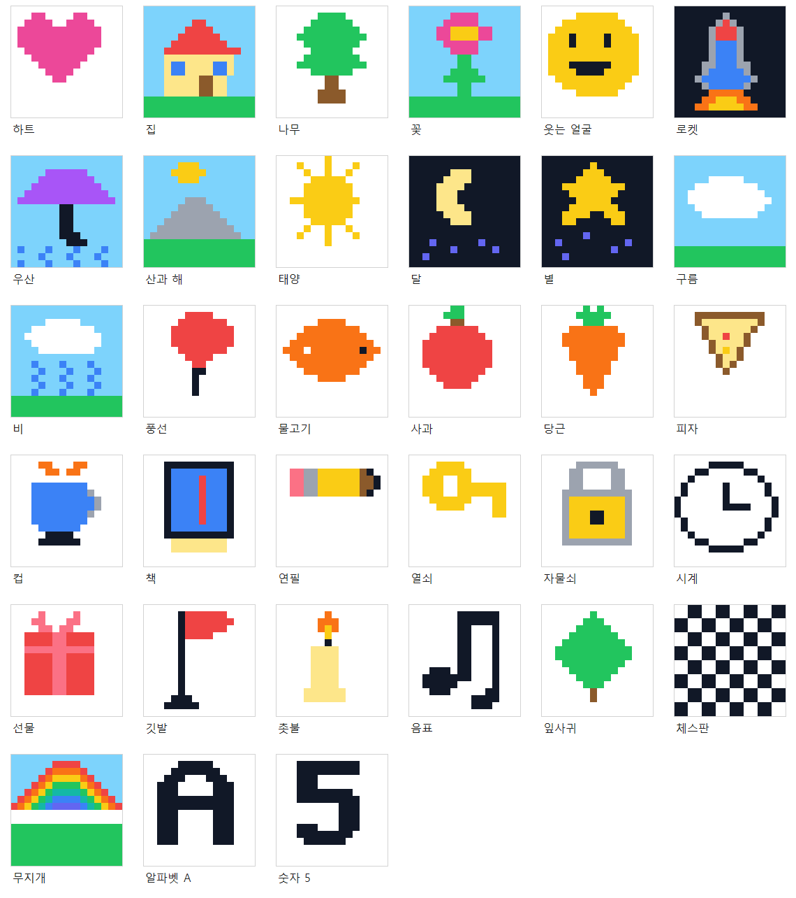
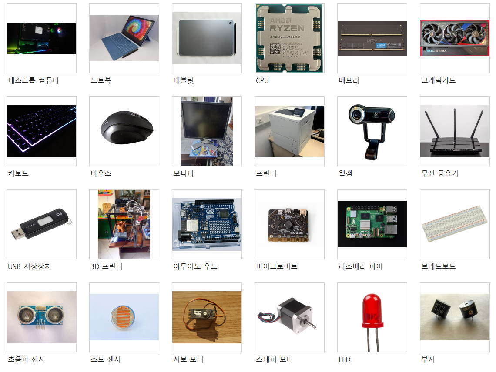

# 교육 게임 콘텐츠 검토

검토일: 2026-09-11. 대상: Edu Games 0.1.17 작업본의 등록 게임 13종.

이 문서는 보강 전 평가를 보존한 기록이다. 후속 구현과 검증 결과는 [2026.09 보강 적용 내역](reinforcement-2026-09.md)을 따른다.

## 결론과 범위

현재 구성은 반복 연습용으로 유용하지만, 문제 수의 확대만으로 학습 활동이 충분해지지는 않는다. 데이터 추출·결측값·AI 모델 훈련소부터 **무엇을 관찰하고, 어떤 근거로 판단하며, 무엇을 정답으로 인정하는지** 수정해야 한다. 객관식 보기 선택, 타자 속도, 카드 기억력을 데이터 분석·프로그래밍·AI 이해 능력과 동일하게 해석해서는 안 된다.

이 문서는 코드·문제 데이터·채점 방식·실제 이미지 자산에 근거한 개발 검토다. 학습 효과에 대한 실험이나 교육과정 적합성 인증은 아니다. 대상 학년이 확정되지 않아 중학생 중심, 고등학생 심화 확장을 가정했다. 초등 적용에는 읽기량·어휘·수학 선행 개념을 별도로 조정해야 한다.

이번에 준비한 것은 평가서, [구현 명세](implementation-spec.md), [신규 문제 초안 28개](seed-cases.json), 정답 검증 코드와 이미지 검토판이다. **운영 게임의 문제·화면·채점은 이번 검토에서 변경하지 않았으며 초안은 자동 출제되지 않는다.** 이전 작업의 접근 제어·점수 재검증·분류 규칙 수정은 그대로 유지한다.

## 게임별 평가

판정은 점수 순위가 아니다. '유지·보강'은 현재 학습 목적을 제한해서 사용할 수 있다는 뜻이고, '수정 필요'는 오개념·판정 불공정 가능성, '재설계 필요'는 목표와 실제 행동의 불일치를 뜻한다. P0은 평가용 공개 전 우선 처리, P1은 학습 활동 보강, P2는 다양성·전이 학습 보강이다.

| 게임 | 현재 규모·행동 | 판정 | 핵심 조치 |
| --- | --- | --- | --- |
| 이진수 변환 | 4~8비트, 8단계, 비트 클릭·숫자 입력, 수동 연습 | 유지·보강 P2 | 0·최댓값·자리올림 경계 포함, 자리값 합을 설명하는 무제한 연습 |
| 문자 코드 | 37기호, 쉬움 26·보통 30·어려움 30 문구, 변환 3종 | 유지·보강 P2 | 임의 치환표와 실제 문자 인코딩·보안 암호 구분, 표의 일대일 대응 검증 |
| 이미지 데이터 | 16색, 16×16 그림 33개, 제작·복원 | 수정 필요 P1 | 빈 배경에 의한 정확도 과대 표시 분리, 모호한 그림 교체, 8×8 입문 |
| 이상치 | 30문제, 값 선택 | 수정 필요 P1 | 판단 기준·정답 없음·다중 후보·집단 기준 추가, 후보와 오류 구분 |
| 결측값 | 30문제, 6개 대체 방식과 값 선택 | 수정 필요 P0 | 대체 정책의 전제 명시, 복수 타당 방법·미대체 인정, 원본/추정 구분 |
| 데이터 시각화 | 30문제, 그래프·해석 보기 선택 | 활동 보강 P1 | 축·열·구간을 직접 구성, 같은 자료에서 나온 타당한 대안과 오해 비교 |
| 데이터 추출 | 6문제, 관련 열·처리 방식 선택 | 재설계 필요 P0 | 실제 행 필터·열 추출·정렬·집계 수행, 학생 성향 단정 소재 교체 |
| 자료구조 실험실 | 30문제: 스택 12·큐 10·우선순위 큐 8 | 활동 보강 P1 | 명령별 상태 구성·추적, 동률·빈 구조·조회/삭제 구분 |
| AI 분류 경계 | 30문제, 규칙 선택·새 점 분류 | 활동 보강 P1 | 규칙 적용과 학습 구분, 경계점·좌표·단위, 학습점으로 예측하는 단계 |
| AI 모델 훈련소 | 숫자·타이타닉 2활동, 라벨링 후 사전 계산 결과 조회 | 재설계 필요 P0 | 관찰 가능한 라벨링, 시뮬레이션의 정직한 표시, 데이터 분리·평가 해석 |
| 코드 타이핑 | 74개: 키워드 4·짧은 코드 24·긴 코드 24·검정 22 | 유지·보강 P2 | 입력 숙련 지표로 제한, 실행 예/출력 예측 연계, 코드 문법 검사 |
| 장치 매칭 | 장치 24종, 6→8→10→12쌍 | 유지·보강 P2 | 사진 식별성 개선, 기능·입출력 역할 확인, 다른 사진으로 전이 |
| 키워드 레인 | 언어별 6개 어휘 묶음, 난이도 3종 | 유지·보강 P2 | 단어 입력과 용어 이해 분리, 정의·사용 예 기반 선택 연습 |

키워드 연습 항목 수는 어휘 수와 다르다. 예를 들어 타이핑의 키워드 4개는 출제용 항목/묶음 수이지, 연습 가능한 단어가 네 개라는 뜻이 아니다.

## 우선 수정 근거

### 1. 데이터 추출: 과제와 실제 수행의 불일치

[문제 원본](../../src/Games/Modules/Data_Extraction/Data_Extraction_Module.php), [화면 로직](../../blocks/data-extraction/view.js).

- 현재는 관련 열과 처리 방법 보기를 고르는 활동이다. 사용자가 실제 결과 행·정렬 순서·집계 표를 만들어 제출하지 않는다. '데이터 추출'의 준비 활동으로는 가능하지만 완성된 추출 실습이라고 보기 어렵다.
- `exercise-lack`는 운동량 부족·앉아 있는 시간의 임계값 없이 4·6·8번을 특정한다. 2번도 비교 후보가 될 수 있는데 제외 근거가 명시되지 않는다.
- `online-class-focus`는 채팅 참여·카메라 켜짐을 집중도의 근거로 사용한다. 장비·환경·참여 방식 등 다른 설명을 배제할 수 없으며, 이 값만으로 학생의 집중도를 정답처럼 판정하면 안 된다.
- `allowance-saving`은 비율 계산 자체는 연습할 수 있으나 '저축 습관이 부족한 학생'이라는 평가는 자료가 뒷받침하지 않는다. 모둠 재료 사용량처럼 가치 판단 없는 합성 소재로 바꾼다.
- `class-recycling`은 '재활용률'과 '1인당 재활용량'을 혼용한다. 4반은 약 0.455kg/명, 6반은 0.5kg/명으로 최솟값은 4반 하나다. 두 반을 함께 최저 정답처럼 설명하지 않는다.
- 처리 보기의 정답 키는 6문제 모두 `b`지만 화면에서 보기 순서는 섞인다. 이를 '항상 화면 두 번째 보기가 정답'인 문제로 오인하지 않는다.

대체 초안: 재고 필터, 대출 가능 AND 쪽수 조건, 잔량 동률 정렬, 1인당 사용량, null과 빈 결과, 구역별 합계의 6문제. 모두 실제 결과 표가 있다.

### 2. 결측값: 방법 선택의 유일성 부족

[문제 원본](../../src/Games/Modules/Missing_Values/Missing_Values_Module.php), [서버 재채점](../../src/Scoring/Quiz_Scorer.php).

`quiz-median`의 `[6,7,null,7,8]`에서 관측 평균·중앙값·최빈값은 모두 7이다. 앞값 유지·등간격 보간 결과도 7이다. 문장에는 특정 방법을 강제할 충분한 조건이 없는데 중앙값만 정답 방법으로 취급한다. **값의 일치와 방법 선택의 타당성은 별도 평가 대상**이어야 한다.

출석 빈칸을 이전 출석으로 채우거나 미응답 취향을 최빈 취향으로 채우는 것은 실제 사실 복원이 아니다. 연습용 대체 정책이라는 전제를 명확히 하고, 실측값·대체값·미확인값을 구분한다. `lunch-count-median`의 30.5는 추정치로는 가능하지만 실제 급식 개수처럼 설명해서는 안 된다.

초안은 정책이 주어진 계산 연습 5개와 미응답을 그대로 두는 판단 1개다. 방법명이 제시된 문제는 안내 연습으로 분류하며, 독립적인 방법 선택 능력을 측정했다고 기록하지 않는다.

### 3. AI 모델 훈련소: 라벨링·훈련·평가의 혼동

[숫자 활동](../../src/Games/Modules/AI_Model_Lab/activities/digit_recognition.php), [타이타닉 활동](../../src/Games/Modules/AI_Model_Lab/activities/titanic_survival.php), [세션 처리](../../src/Games/Modules/AI_Model_Lab/Session_Service.php), [화면](../../blocks/ai-model-lab/view.js), [숫자 생성 스크립트](../../scripts/edu-game/generate_digit_labeling_data.py), [타이타닉 생성 스크립트](../../scripts/edu-game/generate_labeling_game_data.py).

- 손글씨 모양은 학생이 보고 라벨을 판단할 수 있다. 반면 승객 속성만으로 역사적 생존 사실을 알아낼 수 없다. 생존 여부 추측을 '정확한 라벨링' 점수로 주는 것은 과제가 다르다. 기본 활동에서 제외하고, 필요하면 정답이 이미 기록된 역사 자료의 예측 한계 토론으로 분리한다.
- 숫자는 15개(0·1·7 각 5개), 타이타닉은 20개(생존·비생존 각 10개)의 균형 배치를 보여준다. 전체 데이터의 불균형과 화면 배치의 분포를 구분해야 한다.
- 생성 스크립트는 실제 모델 실험을 수행한다. 다만 서비스는 사용자가 이번에 작성한 라벨로 즉시 학습하지 않고, 정답 개수와 모델에 해당하는 사전 계산표를 조회한다. 같은 개수로 다른 항목을 틀려도 같은 결과가 나온다. '모델을 학습시키는 중입니다'는 이를 충분히 설명하지 못한다.
- 여러 실험의 혼동행렬을 평균낸 뒤 정수로 반올림해 표시한다. 저장된 숫자 활동 행렬의 합은 161·162·163·164로 달라지고, 행렬에서 다시 계산한 정확도와 표시 정확도의 차이는 최대 약 0.66%p다. 타이타닉은 합이 267·268로 달라진다. 원자료가 가짜라는 뜻이 아니라 **평균 요약을 한 번의 실험 횟수처럼 보여주는 방식**의 문제다.
- `baseline_accuracy`는 성능표 최솟값을 사용한다. 일반적인 다수 클래스 기준선과 동일하다고 설명하면 안 된다. 라벨 오염 비율·반복 횟수·평균/분산·기준선 정의를 제공해야 한다.
- 전처리 고정값(나이 29.7 등)의 산출 출처를 확인하고 재생성 시 훈련 자료로만 전처리를 맞춘다. 현재 상수가 평가 데이터에서 계산되었다는 증거까지 확보한 것은 아니므로 데이터 누수 발생을 단정하지 않는다. 분할 후 훈련 자료에서만 `fit`하는 원칙은 [scikit-learn 공식 문서](https://scikit-learn.org/stable/common_pitfalls.html)를 따른다.

초안은 훈련 자료만으로 평균을 계산하는 문제, 같은 정확도라도 불량 탐지 재현율이 다른 모델을 비교하는 문제다. 이 두 개가 모델 훈련 기능 자체를 구현한 것은 아니다.

### 4. 이상치: 위치 편향과 정답 없음 누락

[문제 원본](../../src/Games/Modules/Outlier_Detection/Outlier_Detection_Module.php), [화면 로직](../../blocks/outlier-detection/view.js).

30문제의 정답 값 36개는 원본 배열의 5번째 19개, 6번째 10개, 7번째 7개에만 있다(1부터 세는 위치). 화면이 원본 값 순서를 유지하므로 위치에 의존해 맞힐 수 있다. '이상치 없음'은 없고, 선택이 0개면 제출을 막는다.

크거나 드문 값과 기록 오류는 구분해야 한다. 허용 범위·분포·집단·측정 맥락을 제시하고, 확인 전 원본 보존을 기본으로 한다. 이상치를 표시하고 조사하는 것과 자동 삭제는 다르다는 점은 [NIST 통계 핸드북](https://itl.nist.gov/div898/handbook/eda/section3/eda35h.htm)의 설명과도 일치한다.

범위 경계·정답 없음·IQR·집단별 기준 초안을 준비했다. 순서에 의미가 없는 자료만 값과 행 ID를 함께 섞고, 시계열은 위치 편향을 없애기 위해 시간 순서를 파괴하지 않는다.

### 5. 이미지: 배경 정확도와 그림 식별성

[이미지 데이터](../../src/Games/Modules/Image_Data/Image_Data_Module.php), [복원 채점](../../blocks/image-data/view.js).

256칸 전체의 일치 비율을 표시하므로 흰색 기본 화면에서 시계·깃발은 83.2%, 촛불 82.4%, 연필 80.5%, 열쇠 80.1%가 이미 맞는다. **완료에는 모든 칸과 그림 선택의 정답이 필요하므로 빈 화면으로 성공하는 버그는 아니다.** 다만 학습 진행률로 읽으면 실제 작업량보다 높게 보인다. 그림 부분 정확도와 배경에 잘못 찍은 칸을 분리한다.

아래는 기존 33개 데이터를 실제 렌더링한 검토판이다. 관찰상 잎사귀는 나무와 비슷하고, 책은 전자기기처럼 보일 수 있으며, 연필 끝 형태는 식별성이 약하다. 피자는 삼각 조각·토핑으로 식별 가능한 후보다. 이 평가는 검토자의 시각 판단이며 학생의 실제 인식률을 측정한 결과는 아니다. 이름을 가린 학생 파일럿 후 유지·교체한다.



### 6. 장치 사진: 실제 사진만으로 충분하지 않음

[장치 정의](../../src/Games/Modules/Device_Matching/Device_Matching_Module.php), [사진 폴더](../../assets/device-matching/images/).

기존 로컬 사진 24개를 확인했다. 데스크톱·키보드는 어둡고, 노트북은 키보드를 붙인 태블릿과 혼동할 수 있으며, 태블릿은 뒷면 위주다. 모니터·3D 프린터는 주변 환경이 시선을 분산시킨다. 웹캠은 익숙한 화면 위 장착 형태의 대체 사진을 검토한다. 모델 연식은 사진만으로 단정하지 않는다.

새 사진을 내려받거나 라이선스를 재검증한 작업은 이번에 하지 않았다. 대표성·정면 식별성·장치 단독 구도·출처/이용 조건을 확인한 뒤 교체해야 한다. 상세 교체 조건은 구현 명세에 있다.



## 그 밖의 보강

- 시각화는 같은 자료를 잘못 읽었을 때 나오는 오답을 사용한다. 완전히 무관한 분야의 보기만 섞으면 자료를 읽지 않아도 맞힐 수 있다. 그래프 종류만 고르는 단계에서 축·단위·분모·구간을 구성하는 단계로 확장한다.
- 자료구조는 반환값뿐 아니라 매 명령 뒤의 상태를 제출한다. 스택·큐만으로 알고리즘 분야 전체를 다룬다고 표시하지 않는다. 탐색·정렬·절차 설계는 후속 별도 모듈 후보이며 이번에 구현된 활동이 아니다.
- 분류 경계의 수치 규칙·A/B 균형은 이전 수정과 회귀 검사가 있다. 추가 개선은 축 단위·경계 포함·학습/검증 분리·새 점의 근거 설명이다. 임상·신용 판단처럼 실제 의사결정으로 오인하기 쉬운 소재보다 가상 물체의 크기·무게를 우선한다.
- 타이핑 74항목은 개수만으로 충분성을 판단하지 않는다. 문법적으로 완전한 코드와 의도적으로 불완전한 키워드/조각을 구분하고, Python 구문 검사와 C 컴파일 검사를 각각 준비한다. 이번 검토에서 Python/C 컴파일러로 전 예제를 검사하지는 못했다.
- 문자 코드는 치환 표현 활동이다. 임의 코드표를 ASCII·Unicode나 실제 보안 수준의 암호화로 설명하지 않는다. 공백·숫자 포함, 중복 문자 일관성, 인코드/디코드 왕복을 검사한다.
- 이진수는 생성 범위가 1부터 시작해 0이 빠진다. 0·최댓값·2의 거듭제곱 전후를 의도적으로 포함한다. 기존 8행 아케이드·수동 연습 구조는 유지한다.
- 키워드 레인은 영어 입력 속도 지표와 개념 이해 지표를 분리한다. 예약어·내장 함수·일반 용어를 모두 '예약어'로 잘못 가르치지 않는다.

## 초안과 검증

| 게임 | 초안 수 | 포함된 판단 |
| --- | ---: | --- |
| 데이터 추출 | 6 | 필터, AND, 동률 정렬, 파생값, 빈 결과, 집계 |
| 결측값 | 6 | 평균, 중앙값, 최빈값, 시간 보간, 상태 유지, 미대체 |
| 이상치 | 4 | 범위, 없음, IQR, 집단 맥락 |
| 시각화 | 4 | 변화량, 전체 비율, 구간 경계, 상관/인과 |
| 자료구조 | 4 | 비파괴 조회, FIFO, 우선순위 동률, 빈 구조 |
| 분류 경계 | 2 | 경계 포함, 최근접 이웃 |
| AI 모델 훈련소 | 2 | 훈련 전처리, 불균형 평가 |
| 합계 | 28 | 정답·해설·대표 오개념 포함 |

`node tests/content-seeds.cjs`는 실제 계산 결과·중간 상태·데이터 불변식을 검사하며 28문제와 잘못된 콘텐츠 14종의 거부 검사를 통과했다. 자연어 설명의 적절성, 복수 그래프 허용의 교육적 타당성, 학습 효과까지 자동 입증한 것은 아니다. 자유 설명·추정 표시 등 보조 수행은 구현 명세의 별도 루브릭 대상이다.

재현 명령(플러그인 폴더에서 실행):

```powershell
node tests/content-seeds.cjs
D:\php\php.exe tests/regression.php
node tests/client-scoring.cjs D:\php\php.exe
powershell -NoProfile -File scripts/edu-game/render-content-review.ps1
```

실제 WordPress/DB에서의 화면 흐름·반별 권한·동시 제출, 30명 동시 사용과 6개 반 운영, 학생 대상 그림 식별/학습 효과는 별도 승인 기준이다. 코드 타이핑 문법 검증과 사진 이용 조건 검토도 완료 항목으로 취급하지 않는다.
