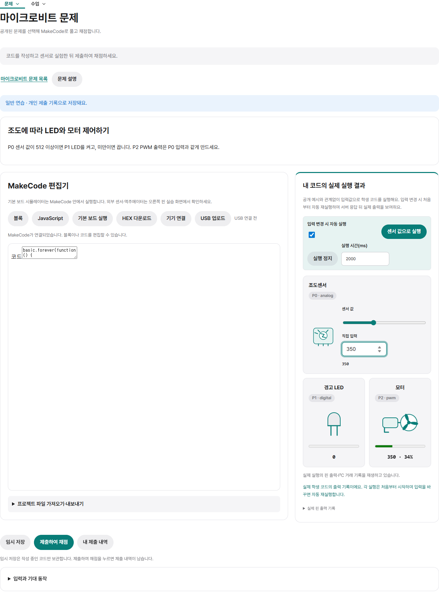
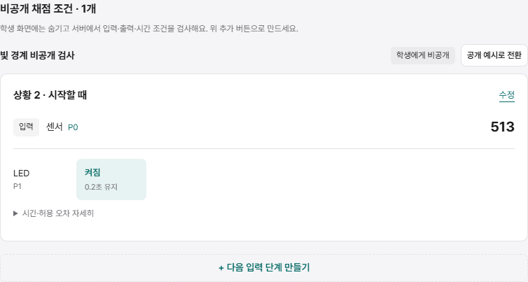

# 실제 학생 코드 실행과 비공개 채점 — 1.0.0-rc.12

대상: OJ Platform 2.5.9 / Addon API 1.9 이상. 작성일: 2026-11-05.

## 학생이 사용하는 두 화면

| 위치 | 출처 | 입력 변경 결과 | 실행기·기록 |
|---|---|---|---|
| 문제 설명 → 기대 동작을 살펴보세요 | 학생에게 공개한 예시의 기대 조건 | 선언된 값의 목표를 그림으로 표시, 미정 값은 미정 안내 | REST 실행 없음·제출 없음 |
| MakeCode로 문제 풀기 → 내 코드의 실제 실행 결과 | 학생의 최신 소스를 컴파일하고 실행한 write·I²C 거래 | 공개 예시와 무관한 허용 입력으로 코드를 새로 실행 | 기존 실행기 필요·제출/점수/프로젝트 저장 없음 |
| 제출하여 채점 | 서버에 저장된 공개·비공개 조건 전체 | 조건별 입력·출력·반응/유지시간·거래 순서를 검사 | 제출과 점수 기록 |

실제 실험은 아날로그 0~1023, 디지털 0/1, I²C 레지스터 0~255를 받습니다. PWM 출력은 MakeCode의 0~1023 범위를 그대로 표시합니다. 예를 들어 공개 예시가 없거나 예시에 0·800만 있어도 센서 513을 넣으면 학생 코드의 분기와 출력 명령에 따라 LED·모터가 바뀝니다. 정답 코드를 대신 실행하거나 설명에서 출력 함수를 추정하지 않습니다. 해당 핀에 실제 출력 기록이 없으면 대기로 남습니다.

MakeCode의 기본 보드 실행 버튼과 별도로 동작합니다. 편집기의 최신 프로젝트를 controller 메시지로 받은 뒤 기존 격리 실행기에 보내고, 반환된 핀·버스 기록을 시간에 맞춰 재생합니다. 프로그램의 delay와 병렬/직렬 동작은 실제 실행 기록을 따릅니다. 모터 그림은 출력 세기의 표현이며 물리적인 RPM·토크를 계산하지 않습니다.

## 자동 실행의 시간과 제한

- 입력·코드 변경 후 600ms를 묶고 실행 시작 간격은 최소 1000ms입니다. 현재 화면에서 요청 하나만 실행하며 대기값은 최신 상태 하나만 유지합니다.
- 각 요청은 프로그램을 **처음부터** 실행합니다. 이전 실행의 변수·카운터·타이머 상태를 이어 가지 않습니다. 서버 통신·컴파일 시간 뒤 기록이 재생되므로 입력 순간의 하드 실시간 반응을 보장하지 않습니다.
- 실행 시간은 100~10000ms, 기본 2000ms입니다. 새 입력·코드·문제로 바뀐 뒤 도착한 과거 결과는 버립니다. 작성 코드·채점 결과·기대 미리보기에 덮어쓰지 않습니다.
- 자동 실행을 끄거나 **실행 정지**를 누르면 예약과 재생을 멈춥니다. 화면 숨김·이동도 멈추며 자동 복귀하지 않습니다. 서버에서 이미 시작한 작업은 완료될 수 있고 응답은 무시됩니다.
- 컴파일/실행 오류는 해당 영역에 표시하고 이전 출력·거래 값을 지웁니다. 코드 수정 후 다시 실행합니다. 통신 오류·429 혼잡은 자동 재시도하지 않습니다. 서버 상태·대기시간 확인 후 다시 켭니다.
- 저장·채점 작업은 진행 중인 실험 응답이 끝난 뒤 실행해 같은 계정의 실행 잠금과 겹치지 않습니다. 탭 간 경합은 기존 서버 잠금과 혼잡 제한으로 제어합니다.
- 로컬 초안 복구·프로젝트 파일 가져오기 후에도 새 코드로 실행합니다. 실제 코드 변경에 대한 미저장 경고는 유지합니다.

## 교사가 비공개 채점 조건을 만드는 곳

1. **문제 → 마이크로비트 문제 → 문제 생성** 또는 기존 문제의 **편집**을 엽니다.
2. **2. 동작 조건 → + 비공개 채점 조건 추가**를 누릅니다. 별도 최상위 메뉴는 없습니다.
3. 검사 이름과 **비공개 채점 · 학생에게 숨김**을 확인합니다.
4. 사용할 핀을 여러 개 선택하고 입력값·기대 출력값, 다음 단계 간격·출력 유지시간을 차례로 정합니다. 한 핀의 켜짐→꺼짐은 **→ 다음 값 추가**를 사용합니다.
5. **핀 N개 함께 적용**을 눌러 **비공개 채점 조건** 목록에 생기는지 확인하고 **문제 저장**합니다. 취소하면 원본은 바뀌지 않습니다.
6. 기존 공개 예시도 **비공개 채점으로 전환**할 수 있습니다. 세밀한 반응 시간·오차·I²C 거래는 해당 검사의 **시간·허용 오차 자세히**를 펼칩니다.

공개 예시는 학생 설명과 채점에 사용하고 비공개 조건은 서버 채점에 사용합니다. 공개 예시가 0개여도 비공개 조건으로 채점할 수 있습니다. 출력/거래 검사가 전혀 없으면 채점 기준을 먼저 작성해야 합니다. 학생 상세·실험 요청에는 비공개 기대 조건을 넣지 않으며 결과 상세도 기존 비공개 보호 규칙으로 가립니다.

## 설치·업데이트

WordPress 관리자에서 새 ZIP으로 업데이트하고 사이트·최적화·CDN 캐시를 비운 뒤 강력 새로고침합니다. 플러그인과 microbit.js/css의 버전 쿼리가 rc.12인지 확인합니다. 실행기가 기존 pxt-microbit/9.1.1;pxt-core/13.0.1;oj-gpio/3으로 준비 상태이면 재설치가 필요하지 않습니다. 실행기 미설치 상태라면 설치 안내서와 docs/INSTALLER.md를 따릅니다.

DB 쿼리·스키마 5·목록 페이지 크기/커서·권한·채점 계약·실행기 코드·USB 번들은 변경하지 않았습니다. 자동 실험에는 기존 실행·권한 조회가 필요하지만 프로젝트·제출·점수 이력을 쓰지 않습니다. 기존 HUSTOJ 컨테이너·포트·DB에 변경을 추가하지 않았습니다. 실제 동시 부하와 용량은 현장 검수가 필요합니다.

## 로컬 검증과 남은 현장 항목

프런트 165개, 공개 예시 없는 비공개 전용 공개 점검을 포함한 PHP 검사, 동결 51개 제품 파일을 검증합니다. 공식 릴리스 킷이 전체 1,575개 검사를 패키징 필수 게이트로 실행합니다. 브라우저는 실제 플랫폼 PHP 렌더러·CSS와 controller/REST fixture를 사용하며 실제 PXT 컴파일러·시뮬레이터로 입력513/100, 슬라이더 연속 변경, 소스 변경·컴파일 오류, 늦은 응답 폐기·요청 직렬화·정지·수업 범위를 검사합니다. 실제 WordPress 인증·MakeCode 서비스·MySQL·Docker를 통합 검증한 것으로 표시하지 않습니다.

근거: [브라우저 검사](browser-focused-validation-1.0.0-rc.12.json), [전체 검사 요약](rc-validation-1.0.0-rc.12.json), [동결 목록](feature-freeze-1.0.0-rc.12.json).

현장에서는 실제 MakeCode 블록/JavaScript 편집·초안 복구·실행기 연결·역할/수업 권한 회수·동시 접속·429 회복·HUSTOJ 병행 부하·DB 계획과 복구를 확인합니다. 실제 보드 없이 실험·채점은 가능하지만 HEX 실행·WebUSB·배선·실물 서보/I²C는 기기로 따로 확인합니다.

