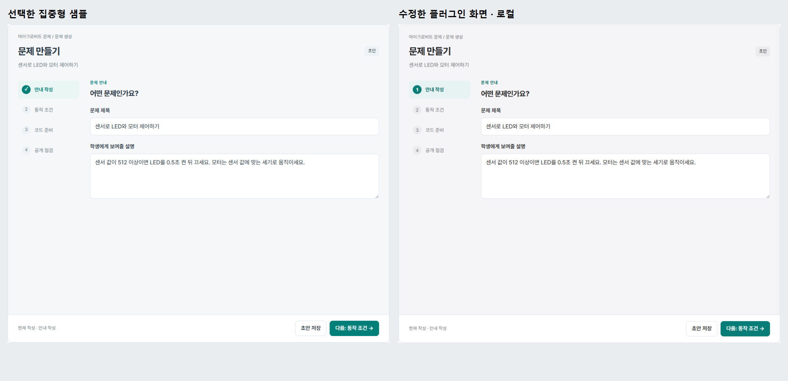
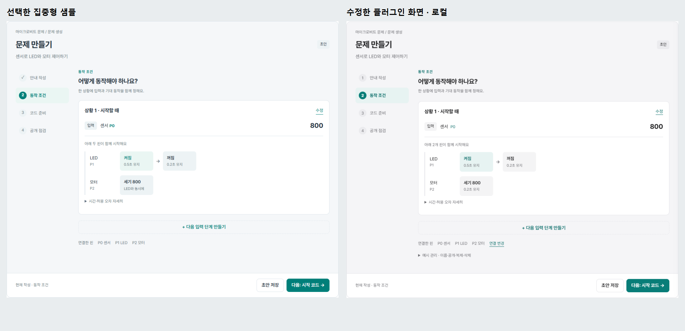
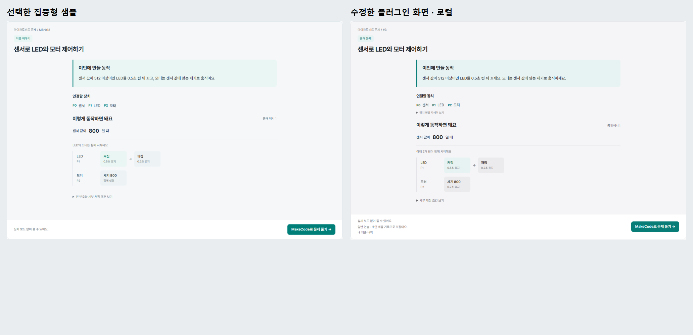

# 집중형 샘플과 실제 화면 일치 점검 — 1.0.0-rc.9

2026-11-04. OJ Platform 2.5.9 / Addon API 1.9 이상. rc.8의 기능은 유지하며 선택한 샘플과 실제 페이지 사이의 디자인 차이를 수정했습니다.

## 수정한 화면

- 생성 첫 화면: 샘플과 같은 제목·설명 입력 폼, 160px 단계 메뉴, 28px 본문 간격, 간결한 제목과 초안 표시.
- 동작 조건: 입력값은 오른쪽, 출력은 80px 장치 이름 열과 켜짐 → 꺼짐 상태 칸으로 표현합니다. 서로 다른 핀은 아래로 나란히 쌓고 함께 시작함을 표시합니다. 단계의 **수정**에서 여러 핀을 한 번에 편집합니다.
- 코드 준비: 실제 MakeCode를 처음 열 때 로드하고 이후 같은 프레임을 유지합니다. 샘플의 회색 자리표시자는 실제 편집기로 대체됩니다.
- 공개 점검: 공개 설정을 한 카드에 모으고 반복 안내를 줄였습니다. 실제 공개는 기존 서버 점검과 명시적 최종 확인을 거칩니다. 샘플의 장식용 완료 표시로 점검 성공을 대신하지 않습니다.
- 문제 보기: 설명·장치·공개 예시를 가운데 읽기 영역에 배치하고 하단에 MakeCode 풀이 버튼을 둡니다. 난이도 자료가 없어 샘플의 ‘처음 배우기’ 대신 실제 공개 상태를 표시합니다. 수업 배정과 제출 내역은 기존 범위를 유지합니다.
- 버튼은 8px 사각 모서리로 통일합니다. 모바일은 짧은 네 단계 메뉴와 세로 장치 행을 사용합니다. 테마의 넓은 버튼·제목 규칙이 뒤에 로드되어도 구성요소의 크기를 유지합니다.

예시 복제·삭제는 **예시 관리**, 정확한 시간과 허용 오차는 **시간·허용 오차 자세히**, 배선 변경은 **연결 변경**에서 엽니다. 여러 핀 일괄 설정과 시간 조건의 의미는 [rc.8 기능 안내](FOCUSED-UI-1.0.0-rc.8.md)를 따릅니다.

## 비교 근거

선택한 원본을 tests/fixtures/focused-reference.html에 그대로 보관하고 SHA-256을 기록합니다. 원본과 실제 PHP 렌더러·플랫폼 CSS·제품 JS/CSS를 같은 예시, 같은 구성요소 너비로 비교합니다. 샘플의 가짜 전역 상단 메뉴는 제외하고 글꼴은 실제 플랫폼 글꼴을 로드합니다. 외부 사이트의 메뉴를 복제하지 않으며 제품 색상은 플랫폼의 밝음/어두움 토큰을 사용합니다.

1280/390/320px에서 버튼 모서리·글자·여백, 제목 위치, 단계 메뉴, 동작 카드 시작 위치·높이, 장치 이름 열·상태 칸, 읽기 영역을 비교합니다. 제목·동작 카드와 첫 입력칸의 위치 차이는 3px 이내로 제한합니다. 생성 네 화면, 모달, 취소·저장·공개 점검, 실제 코드 변경의 이탈 경고도 별도로 확인합니다. 원본과 실제 화면의 의도적인 차이는 코드 편집기·공개 점검·권한/기록 정보와 테마 색상입니다.

로컬 근거: [브라우저 기록](browser-focused-validation-1.0.0-rc.9.json), [시안 수치 비교](design-fidelity-validation-1.0.0-rc.9.json), [전체 검사](rc-validation-1.0.0-rc.9.json). 테스트의 REST·MakeCode iframe 응답은 통제된 로컬 fixture이며 실제 WordPress·MakeCode 서비스가 아닙니다.

## 설치 후 실제 사이트 확인

1. WordPress 플러그인 목록에서 1.0.0-rc.9인지 확인합니다. ZIP 덮어쓰기 설치 후 활성화하고, 기존 PXT 9.1.1/core 13.0.1·oj-gpio/3 실행기가 준비 상태이면 화면 수정 때문에 재설치하지 않습니다.
2. 사이트 캐시·최적화 플러그인·CDN 캐시를 지운 뒤 브라우저 강력 새로고침을 합니다. Network에서 microbit.css / microbit.js의 버전 쿼리가 현재 설치 버전인지 확인합니다.
3. 문제 생성의 안내 → 동작 → 코드 → 공개 및 학생 보기를 비교합니다. 두 단계가 동시에 보이거나 버튼이 알약 모양이면 실제 테마 규칙·추가 CSS·오래된 번들을 조사합니다.
4. 실제 WordPress 테마, 메뉴 설정, 모바일 가상 키보드, MakeCode 서비스의 연결과 실제 사용자 권한을 확인합니다. HEX·WebUSB는 실물 장치 시험이 별도로 필요합니다.

이번 작업에서는 Windows 브라우저 주소를 컴퓨터 사용 도구가 확실히 확인하지 못해 실제 사이트 조작이 종료되었습니다. 운영 사이트 설치·캐시·테마와 동일한 화면으로 배포되었다고 인증하지 않습니다. DB 쿼리·스키마 5, 권한·수업 기록 분리, 채점 실행기와 USB 번들은 변경하지 않았습니다.
