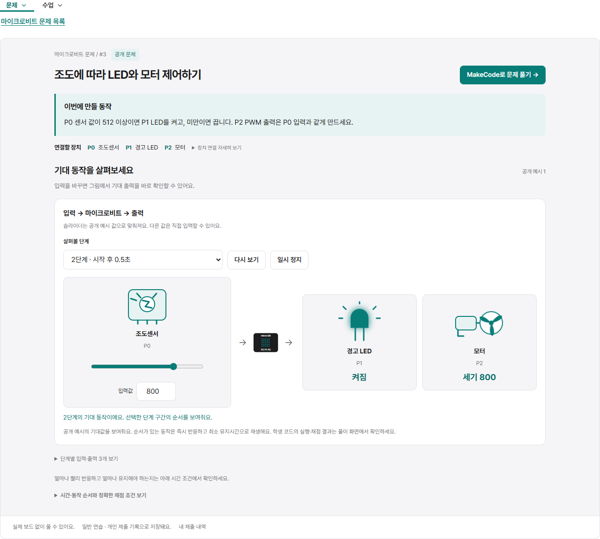
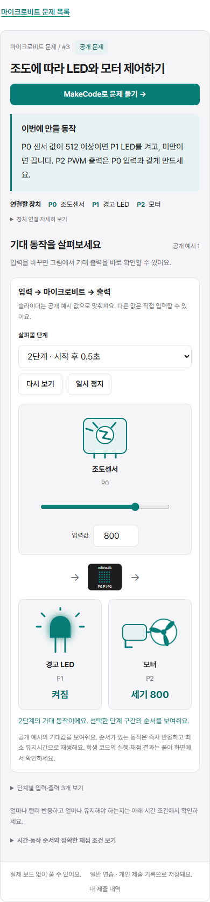

# 센서·LED·모터 기대 동작 미리보기 — 1.0.0-rc.11

2026-11-05. 학생 문제 보기에서 실제 기기나 실행 서비스 연결 없이 공개 예시의 기대 동작을 살펴볼 수 있습니다. OJ Platform 2.5.9 / Addon API 1.9 이상이 필요합니다.

## 학생이 사용하는 방법

1. **기대 동작을 살펴보세요**에서 센서 그림과 슬라이더를 확인합니다. 슬라이더는 교사가 공개한 입력값 중 가까운 값으로 맞춰집니다.
2. 입력값을 바꾸면 LED가 켜지거나 꺼지고, PWM LED는 밝기가 바뀝니다. 모터는 출력 세기에 따라 회전 그림의 속도가 바뀝니다. 숫자로도 상태를 확인할 수 있습니다.
3. 여러 입력이 있으면 **조절할 입력**에서 센서나 I²C 레지스터를 고릅니다. 다른 입력값은 유지됩니다. **살펴볼 단계**는 그 단계의 전체 입력 상태를 불러옵니다.
4. **다시 보기**는 기대 출력 순서를 처음부터 재생하고 **일시 정지**는 현재 그림과 순서를 멈춥니다. 단계별 카드의 **그림으로 보기**도 같은 입력 상태를 불러옵니다.
5. 코드 작성·실행·제출은 기존 **MakeCode로 문제 풀기**에서 진행합니다. 미리보기 조작은 프로젝트·제출·점수 기록을 만들지 않습니다.

## 공개 조건과 시간의 의미

이 화면은 공개 예시에 명시된 입력과 기대값을 보여주는 설명용 미리보기입니다. 문제 설명에서 임계값·수식을 추측하거나 비공개 채점 조건을 이용하지 않습니다. 예시에 없는 값을 직접 입력하면 **기대 출력이 공개 예시에 없음**으로 표시하고 LED·모터를 미정 상태로 바꿉니다. 같은 입력에 서로 다른 기대 순서가 있으면 단계 선택을 요청합니다.

직렬 출력은 즉시 반응하는 경우를 선택해 앞 값의 최소 유지시간 뒤 다음 값을 표시합니다. 출력 반응 한도를 학생 코드가 사용한 지연으로 간주하지 않습니다. 다음 기준 시점 이전 구간만 재생하며, 조건이 없는 출력이나 한 핀의 복합 조건을 임의로 정하지 않습니다. 최소 유지가 끝났다고 자동으로 끄지 않습니다. 반응·유지시간·오차·고정 시각·I²C 순서는 원래 채점 계약을 그대로 사용합니다.

모터 회전은 출력 세기의 상대적인 그림이며 물리 RPM·토크를 계산하지 않습니다. 서보 각도는 그림과 숫자로 표시하고 펄스 폭은 마이크로초로 표시합니다. 펄스 폭을 임의의 물리 각도로 변환하지 않습니다. I²C 입력은 선언한 레지스터 초기값을 사용하며 거래 바이트·순서는 기존 상세 조건에서 확인합니다.

## 성능·접근성·보존 범위

- 입력·예시·단계·일시 정지 조작에 REST나 DB 요청을 추가하지 않습니다. 그림은 외부 이미지나 라이브러리 다운로드가 없는 코드의 SVG입니다.
- 많은 입력도 조절할 입력 하나만 마운트합니다. 순서 재생의 대기 타이머는 최대 하나이며 입력·예시·페이지를 바꾸거나 화면이 숨겨지면 정리합니다.
- 모터는 CSS 변환으로 회전하고 운영체제의 모션 감소 설정에서는 회전을 생략합니다. 숫자 상태와 순서는 계속 확인할 수 있습니다.
- 원래 예시·프로젝트·점수·수업 범위를 바꾸지 않습니다. 비공개 예시는 미리보기 모델에 포함하지 않습니다. DB 쿼리·스키마 5·PXT·실행기·USB 번들은 rc.10과 같습니다.

## 설치와 확인

WordPress에서 새 ZIP으로 업데이트하고 플러그인과 CSS/JS 버전이 rc.11인지 확인합니다. 사이트·최적화·CDN 캐시를 지운 뒤 강력 새로고침합니다. 호환 실행기 pxt-microbit/9.1.1;pxt-core/13.0.1;oj-gpio/3이 준비 상태이면 그림 미리보기 때문에 실행기를 다시 설치할 필요가 없습니다. 학생 코드의 실제 시뮬레이션·채점은 실행 서비스가 필요합니다.

이미지는 실제 제품 PHP/JS/CSS와 플랫폼 스타일을 사용하는 로컬 브라우저 검증입니다. 실제 WordPress·MakeCode 서비스·MySQL·Docker/HUSTOJ 부하·물리 USB 승인은 기존 현장 체크리스트에서 확인합니다.

근거: [브라우저 검사](browser-focused-validation-1.0.0-rc.11.json), [로컬 검사](rc-validation-1.0.0-rc.11.json), [제품 동결](feature-freeze-1.0.0-rc.11.json).
