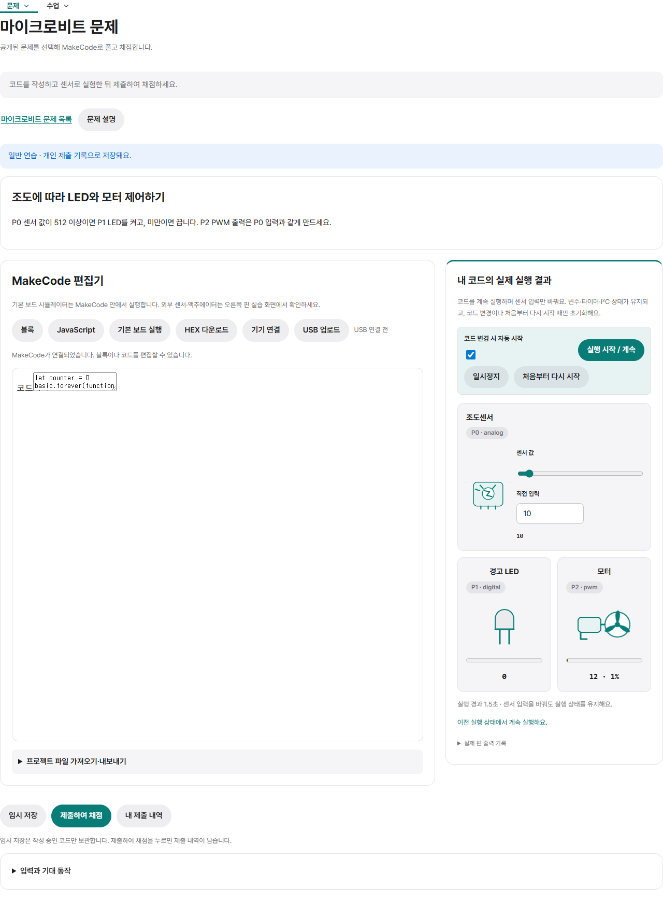

# 상태를 유지하는 실제 코드 실행 — 1.0.0-rc.13

작성일: 2026-11-05. OJ Platform 2.5.9 / Addon API 1.9 이상. rc.12의 입력별 재실행 방식을 교체했습니다.

## 학생에게 달라진 동작

최초에 MakeCode의 최신 프로젝트를 기존 Docker 실행기에서 컴파일합니다. 이후 같은 PXT 프로그램을 브라우저의 격리 Worker에서 계속 실행하며 GPIO 입력 맵과 외부 I²C 입력값만 바꿉니다. 입력 변경은 프로그램을 재시작하지 않습니다. 공개 예시가 없어도 실행하고, 코드에서 발생한 실제 write·I²C 거래를 그림·숫자로 표시합니다.

| 조작 | 변수·타이머·I²C 상태 | 서버 요청 |
|---|---|---|
| 센서 슬라이더·숫자·I²C 입력 변경 | 유지, 다음 센서 읽기부터 새 값 사용 | 0개 |
| 일시정지 → 실행 시작 / 계속 | 변수·남은 대기·포인터·레지스터 유지 | 0개 |
| 페이지 숨김 → 돌아와 계속 | 상태 보존·숨김 동안 가상 시간 정지 | 0개 |
| 처음부터 다시 시작 | 새 런타임·가상 보드/장치 초기화, 현재 외부 입력 사용 | 컴파일 |
| 코드 편집·가져오기·초안 복구 | 이전 런타임 교체 후 새 코드 실행 | 컴파일 |
| 페이지 이동·닫기·새로고침 | 기존 런타임 종료, 다음 진입은 새 실행 | 다음 진입 시 컴파일 |
| 제출하여 채점 | 서버에서 저장된 공개·비공개 조건을 독립 실행 | 제출·채점 |

**실행 시작 / 계속**, **일시정지**, **처음부터 다시 시작**을 구분했습니다. 코드 변경 시 자동 시작을 끄면 새 코드는 명시적으로 시작합니다. 이미 실행 중인 프로그램의 센서 입력은 이 설정과 관계없이 전달합니다. 저장·다운로드·채점 같은 작업 중에는 실행을 일시정지하고, 원래 실행 중이던 세션만 작업 뒤 이어갑니다.

센서 값이 바뀌어도 코드가 읽지 않으면 출력은 바뀌지 않습니다. 예를 들어 LED를 켜고 0.5초 기다리는 동안 센서를 바꾸면 **남은 대기는 이어지고**, 대기 뒤 analogRead에서 새 값을 읽습니다. 프로그램이 다음 읽기를 실행할 때 LED·모터가 반응합니다. 실제 CPU 주기·전압·모터 관성·서보 토크를 계산하거나 하드 실시간 반응을 보증하지는 않습니다.

## 기대 미리보기·실제 실행·채점의 구분

- 문제 설명의 **기대 동작을 살펴보세요**는 공개 예시에 선언된 목표만 보여 줍니다. 알려지지 않은 값의 정답을 추정하지 않습니다.
- 풀이의 **내 코드의 실제 실행 결과**는 학생 소스의 현재 실행 결과입니다. 공개 예시와 관계없이 아날로그0~1023·디지털0/1·I²C 바이트0~255를 사용합니다. PWM은 MakeCode0~1023, 서보는 각도/펄스 종류를 구분합니다.
- **제출하여 채점**은 서버에서 저장된 공개·비공개 입력·기대 출력·시간·거래 순서를 검사합니다. 브라우저가 표시한 출력이나 점수를 채점 증거로 받지 않습니다. 실험·입력 변경은 프로젝트·제출·점수를 저장하지 않습니다.

MakeCode 안의 기본 보드 시뮬레이터와 외부 장치 실습 Worker는 별도 세션입니다. 블록/JavaScript에서 저장된 최신 main.ts를 외부 실습과 서버 채점에 사용합니다. 기존 GPIO·서보·I²C 지원 범위를 유지하며 임의 GitHub 확장·SPI·초음파·내장 센서 전용 입력이나 연속 회전 서보의 물성을 새로 지원하는 변경은 아닙니다.

## 입력·시간·수명과 성능

입력 메시지는 최신 상태 하나를 약16ms씩 묶어 Worker로 보냅니다. 같은 런타임의 변수·타이머 큐·병렬 작업·난수 상태·I²C 포인터/프로그램이 쓴 레지스터를 유지합니다. 다른 센서를 바꿀 때 I²C 레지스터의 이전 외부 입력을 반복 덮어쓰지 않습니다. 그 외부 레지스터를 직접 바꿀 때만 새 입력을 적용합니다.

컴파일은 소스 변경을600ms 묶고 시작 간격을 최소1초로 제한하며 한 요청씩 실행합니다. 센서 조작에는 HTTP 요청·WordPress 인증 조회·DB 쿼리가 없습니다. 최초 컴파일은 기존 요약 권한 조회와 계정 실행 잠금을 쓰고, 오래된 응답·페이지 종료 뒤 응답은 버립니다. DB 스키마5·저장 SQL·커서 목록·인덱스는 바꾸지 않았습니다.

출력 표는 GPIO60행·I²C100행을 유지합니다. Worker는 가상 시간 조각과 작업량을 제한하고, 과도한 출력·응답 없는 반복문을 중지해 안내합니다. 처음 실행 중 일시정지를 눌러도 응답 없는 Worker의 감시는 유지합니다. 화면 숨김은 보존 일시정지하며 자동 복귀하지 않습니다. 모션 감소는 숫자 결과를 유지하고 회전 애니메이션만 멈춥니다.

사이트 DOM·쿠키와 분리한 opaque-origin sandbox iframe 안에서 Worker를 생성하며 내부 CSP는 네트워크를 차단합니다. 호스트는 sandbox 없이 열거나 같은 출처로 임베드한 경우 실행 연결을 거부합니다. 컴파일된 코드는 이 공간에서만 평가합니다. 메인 페이지에서는 실행하지 않습니다. 세션 종료 시 Worker·통신 포트·감시/입력 타이머·iframe을 해제합니다. 실제 사이트의 HTTP CSP·최적화/지연 로딩·CDN·메모리 제한은 현장 검수가 필요합니다.

현재 권한은 컴파일 전후와 저장·제출 때 서버에서 확인합니다. 이미 내려받은 학생 코드의 로컬 실행은 입력마다 권한을 재조회하지 않습니다. 권한 회수 뒤 새 컴파일·저장·제출은 차단하고, 이미 실행 중인 로컬 세션은 닫을 때까지 보유할 수 있습니다. 서버 비공개 조건은 이 세션에 들어가지 않습니다.

## 설치와 업데이트

1. 생성된 설치 안내서의 순서에 따라 WordPress에 rc.13 ZIP을 설치하고 사이트·최적화·CDN 캐시를 비웁니다. JS와 sandbox 자산에 현재 버전 쿼리를 붙입니다.
2. 기존 한 번 설치 명령으로 마이크로비트 실행기도 rc.13으로 갱신합니다. 서버 준비22단계와 docs/INSTALLER.md를 따릅니다. 새 서비스나 포트 종류는 추가하지 않고 기존 마이크로비트 실행기만 갱신합니다. HUSTOJ 컨테이너·DB·포트·Docker daemon 설정을 바꾸는 코드는 추가하지 않았습니다.
3. 채점 식별자는 pxt-microbit/9.1.1;pxt-core/13.0.1;oj-gpio/3을 유지합니다. 상태 유지용 POST /v1/compile과 health의 liveProtocol:oj-live/1이 추가됩니다. 구 실행기는 상태 유지 실행에서 업데이트를 안내하며 재실행 방식으로 대체하지 않습니다.
4. 실제 MakeCode의 블록·JavaScript·파일 가져오기·초안 복구와 브라우저 CSP/iframe/Worker를 확인합니다. 페이지 이동은 실행을 종료하므로 수업 안내에도 구분합니다.

비공개 조건은 **문제 → 마이크로비트 문제 → 문제 생성/편집 → 2. 동작 조건 → + 비공개 채점 조건 추가**에서 기존과 같이 작성합니다. 공개 예시0개라도 비공개 조건으로 채점할 수 있습니다.

## 검증 근거와 현장 항목

- PHP1,264·프런트171·설치기26·실행기108·동결4·REST15·Python26, 총1,614개는 공식 릴리스 킷의 패키징 필수 검사입니다. PXT 번들 재현성·고지·버전과 제품60개 해시도 검사합니다.
- 고정 Node24.22.1에서 실제 PXT 컴파일러·브라우저 Worker를 사용하는 Chromium42개 흐름과 페이지 오류0개를 확인했습니다. 반복 입력 중 카운터 유지, 0.5초 대기 중 입력 변경, 보존 일시정지/재개, 명시적 초기화, 시작 중 무한 루프 회수, I²C 레지스터 유지·서보 연동과 수업 범위를 포함합니다.
- 브라우저는 실제 플랫폼 PHP 렌더러·CSS와 로컬 controller/REST fixture를 사용합니다. 실제 MakeCode 서비스·WordPress 인증·MySQL·운영 Docker·HUSTOJ 병행 부하·보드 업로드를 검증한 것으로 표시하지 않습니다.

근거: [브라우저 보고서](browser-focused-validation-1.0.0-rc.13.json), [전체 검사 요약](rc-validation-1.0.0-rc.13.json), [제품 동결](feature-freeze-1.0.0-rc.13.json), [현장 체크리스트](ACCEPTANCE-CHECKLIST.md).

