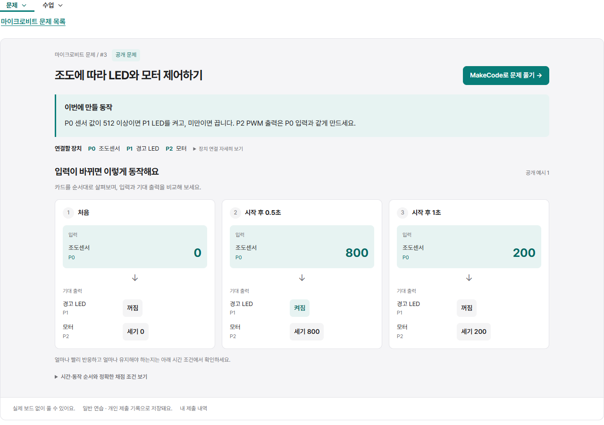
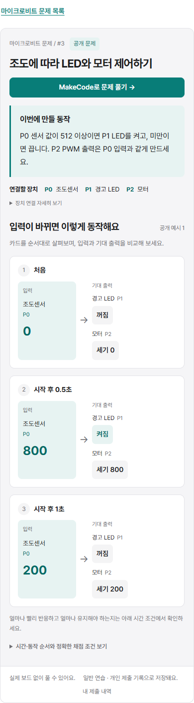

# 학생이 읽기 쉬운 문제 보기 — 1.0.0-rc.10

2026-11-05. OJ Platform 2.5.9 / Addon API 1.9 이상. 작성 화면의 집중형 흐름은 유지하고 학생이 문제를 읽는 화면을 개선했습니다.

## 화면 읽는 순서

1. **제목과 이번에 만들 동작**을 읽습니다. 제목 옆 **MakeCode로 문제 풀기**로 바로 시작할 수 있습니다.
2. **연결할 장치**에서 핀 번호와 장치 이름을 확인합니다. 배선 표는 필요할 때 펼칩니다.
3. **입력이 바뀌면 이렇게 동작해요**에서 각 카드의 입력과 기대 출력을 비교합니다. 데스크톱은 처음·시작 후 0.5초·시작 후 1초를 세 카드로 나란히, 모바일은 카드 안에서 입력 → 출력을 좌우로 읽습니다.
4. **시간·동작 순서와 정확한 채점 조건 보기**를 열어 반응 한도, 최소 유지시간, 오차와 핀·I²C 조건을 확인합니다. 상세 내용은 열 때 구성합니다.

카드의 시간은 예시 실행 시작 기준입니다. 단일 출력 카드에서는 반복되는 유지시간을 생략하고, 한 핀의 여러 출력은 값과 유지시간을 화살표로 연결합니다. 조건을 생략해서 채점하는 것은 아니며 원래 시간·신호·오차·I²C 순서는 그대로 적용합니다. 숫자로만 주어진 센서 값에 어둠·밝음·물리 단위를 추측해 붙이지 않습니다.

여러 공개 예시가 있으면 **살펴볼 예시**에서 하나씩 선택합니다. 예시는 처음부터 따로 실행하며 입력 상태를 서로 가져오지 않습니다. 긴 예시는 처음 세 단계만 표시하고 **다음 단계 보기**로 세 개씩 펼칩니다. 다음 단계에서도 앞서 설정된 입력값은 유지해 표시하되 원문 데이터를 수정하거나 없는 초기값을 만들지 않습니다.

## 유지한 동작과 성능

- 문제 생성의 네 단계·여러 핀 모달·저장·공개 전 점검은 유지합니다. 서보 각도/펄스, 직렬 출력, I²C 레지스터와 바이트 순서를 바꾸지 않습니다.
- 공개 예시만 선택·표시하고 수업 배정과 읽기 전용 권한을 유지합니다. 읽기 전용 수업에 풀이 버튼을 추가하지 않습니다.
- 예시 전환·다음 단계·시간 조건 열기는 추가 REST 요청을 보내지 않습니다. 처음 표시하는 단계와 상세 DOM을 제한합니다.
- DB 쿼리·스키마 5·목록 페이지 크기·인덱스·채점 실행기·USB 번들·PXT 의존성은 rc.9 동결 해시와 같습니다.

## 설치와 확인

WordPress에서 새 ZIP으로 업데이트하고 플러그인 버전과 microbit.css/microbit.js의 버전 쿼리가 rc.10인지 확인합니다. 사이트·최적화 플러그인·CDN 캐시를 지운 뒤 강력 새로고침합니다. 기존 실행기의 식별자가 pxt-microbit/9.1.1;pxt-core/13.0.1;oj-gpio/3이고 준비 상태이면 화면 개선 때문에 재설치할 필요가 없습니다.

이 문서의 이미지는 제품 PHP/JS/CSS와 실제 플랫폼 스타일을 사용하는 로컬 브라우저 검증 화면입니다. REST와 MakeCode 메시지는 통제된 fixture입니다. 실제 사이트에 설치하거나 테마·캐시·사용자 로그인 환경을 검증한 결과는 아닙니다. 실제 WordPress/MySQL·Docker/HUSTOJ 부하·물리 USB 승인은 기존 현장 체크리스트를 따릅니다.

근거: [브라우저 기록](browser-focused-validation-1.0.0-rc.10.json), [로컬 검사 요약](rc-validation-1.0.0-rc.10.json), [동결 파일](feature-freeze-1.0.0-rc.10.json).
